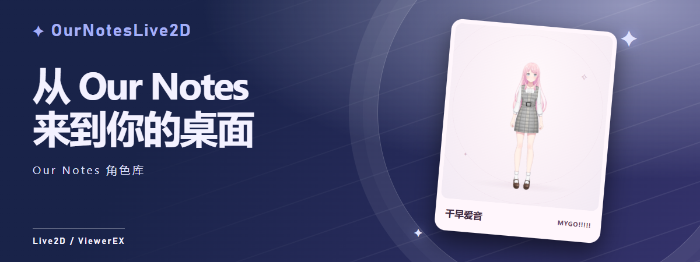
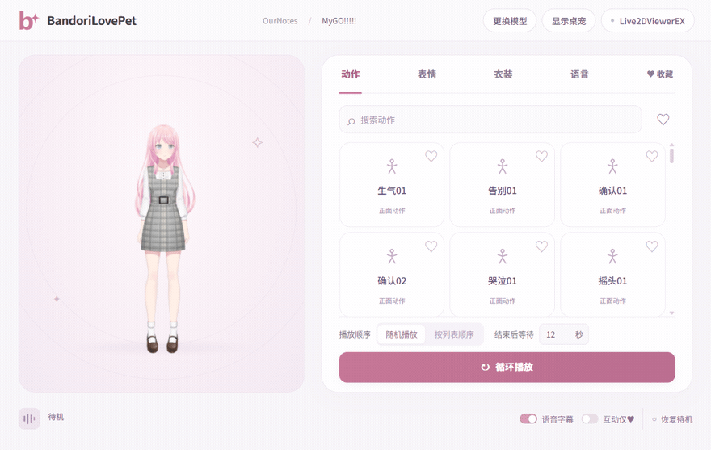

# OurNotesLive2D-Windows

《BanG Dream! Our Notes》Live2D 角色库。收录 MyGO!!!!!、Ave Mujica、夢限大みゅーたいぷ、millsage 与一家Dumb Rock!。衣装、动作、表情与语音按角色整合。

**[挑选角色 ZIP](https://github.com/jiangyunxi222/OurNotesLive2D-Windows/releases/tag/V261119)** · [高松灯最新衣装](https://github.com/jiangyunxi222/OurNotesLive2D-Windows/releases/tag/V261122) · [手机版 WPK](https://github.com/jiangyunxi222/OurNotesLive2D-Mobile/releases/latest) · [Steam 创意工坊 · 千早爱音](https://steamcommunity.com/sharedfiles/filedetails/?id=3838891634)

**V261119 提供 27 个单角色 ZIP。** 高松灯的生日衣装在 V261122。下载时选择 **Assets** 里带角色全名的 ZIP。

## 角色实录

*MyGO!!!!! · 千早爱音（OurNotes）· 动作与演出服换装实录*

## 导入

### BandoriLovePet · Windows / Android

1. 在 BandoriLovePet 点「选择模型」，直接导入单角色 ZIP。
2. 在应用内预览，或点「显示桌宠」。Android 显示桌宠需授予浮窗权限。

Windows 也可导入解压后的 `00_integrated.model3.json`。[BandoriLovePet 使用指南](https://github.com/jiangyunxi222/BandoriLovePet)

### Live2DViewerEX · Windows 本地导入

1. 解压 ZIP，保留完整角色目录，包括 `ControlPanel` 和 `assets`。
2. 首次使用或升级后，双击一次 `ControlPanel/EnableAutoStart.cmd`。
3. 在 Live2DViewerEX 导入 `00_integrated.model3.json`。控制台会在后台启动。
4. 点击角色腿部，再点「打开面板」进入网页控制台。

控制台支持收藏与循环播放。可分别设置动作、语音和换装的顺序与间隔。语音页支持添加本地音频和字幕。[Live2DViewerEX](https://store.steampowered.com/app/616720/Live2DViewerEX/)

### Steam 创意工坊

在工坊订阅角色，再从 ViewerEX 的创意工坊列表加载。需要包内网页控制台时，请按上面的 Windows 本地导入流程操作。[工坊示例 · 千早爱音](https://steamcommunity.com/sharedfiles/filedetails/?id=3838891634)

工坊角色包的源码与发布资料集中在独立仓库。[OurNotes 创意工坊源码](https://github.com/jiangyunxi222/OurNotesLive2D-Workshop)

## 角色互动

| 点击位置 | 互动 |
| --- | --- |
| 头顶或刘海上部 | 切换表情 |
| 脸部下半部 | 播放随机语音，可显示字幕 |
| 上身中央 | 播放普通动作 |
| 屏幕右侧 / 左侧手臂 | 播放角色左臂 / 右臂动作 |
| 腰部或衣服中段 | 随机换装 |
| 腿部或衣服下段 | 打开菜单 |

头像形态的上身、腰部和腿部触控区位于头像下方。语音与字幕以各角色包为准，来源见 `assets/voices/voice-sources.json`。

## 导入排查

- **ZIP 无法导入**。请下载发布页 Assets 中的单角色 ZIP。`Source code (zip)` 是仓库快照。
- **腿部菜单打不开**。运行 `EnableAutoStart.cmd`，再完整重载 `00_integrated.model3.json`。
- **控制台提示启动 ViewerEX**。先在 ViewerEX 加载角色。独立安装未被识别时，将安装路径写入 `ControlPanel/viewer-path.txt`，再重启控制台。

## 角色图鉴

展开全部角色与衣装数量

以下为仓库收录的角色和衣装。[角色发布页](https://github.com/jiangyunxi222/OurNotesLive2D-Windows/releases)

| 团体 | 角色 | 衣装数 | 整合入口 |
| Ave Mujica | 三角初华 | 11 | [导入入口](<Ave Mujica/三角初华/00_integrated.model3.json>) |
| Ave Mujica | 丰川祥子 | 9 | [导入入口](<Ave Mujica/丰川祥子/00_integrated.model3.json>) |
| Ave Mujica | 八幡海铃 | 9 | [导入入口](<Ave Mujica/八幡海铃/00_integrated.model3.json>) |
| Ave Mujica | 祐天寺若麦 | 7 | [导入入口](<Ave Mujica/祐天寺若麦/00_integrated.model3.json>) |
| Ave Mujica | 若叶睦 | 15 | [导入入口](<Ave Mujica/若叶睦/00_integrated.model3.json>) |
| MyGO!!!!! | 千早爱音 | 10 | [导入入口](<MyGO!!!!!/千早爱音/00_integrated.model3.json>) |
| MyGO!!!!! | 椎名立希 | 9 | [导入入口](<MyGO!!!!!/椎名立希/00_integrated.model3.json>) |
| MyGO!!!!! | 要乐奈 | 6 | [导入入口](<MyGO!!!!!/要乐奈/00_integrated.model3.json>) |
| MyGO!!!!! | 长崎爽世 | 7 | [导入入口](<MyGO!!!!!/长崎素世/00_integrated.model3.json>) |
| MyGO!!!!! | 高松灯 | 8 | [导入入口](<MyGO!!!!!/高松灯/00_integrated.model3.json>) |
| millsage | 伊泽枣 | 7 | [导入入口](<millsage/伊泽枣/00_integrated.model3.json>) |
| millsage | 和泉朋花 | 8 | [导入入口](<millsage/和泉朋花/00_integrated.model3.json>) |
| millsage | 汐见萤 | 4 | [导入入口](<millsage/汐见萤/00_integrated.model3.json>) |
| millsage | 泽海奏多 | 6 | [导入入口](<millsage/泽海奏多/00_integrated.model3.json>) |
| millsage | 滨崎茉幌 | 9 | [导入入口](<millsage/滨崎茉幌/00_integrated.model3.json>) |
| millsage | 琴平凪 | 8 | [导入入口](<millsage/琴平凪/00_integrated.model3.json>) |
| millsage | 琴平树 | 3 | [导入入口](<millsage/琴平树/00_integrated.model3.json>) |
| 一家Dumb Rock! | 宁月家的女仆 | 1 | [导入入口](<一家Dumb Rock!/佣人（sub_shizukus_maid）/00_integrated.model3.json>) |
| 一家Dumb Rock! | 四宫宁月 | 7 | [导入入口](<一家Dumb Rock!/四宫宁月/00_integrated.model3.json>) |
| 一家Dumb Rock! | 蕾叶的奶奶 | 1 | [导入入口](<一家Dumb Rock!/奶奶（sub_raikas_grandmother）/00_integrated.model3.json>) |
| 一家Dumb Rock! | 心玖的母亲 | 1 | [导入入口](<一家Dumb Rock!/妈妈（sub_mikus_mother）/00_integrated.model3.json>) |
| 一家Dumb Rock! | 宁月的母亲 | 1 | [导入入口](<一家Dumb Rock!/宁月的母亲/00_integrated.model3.json>) |
| 一家Dumb Rock! | 宁月的父亲 | 1 | [导入入口](<一家Dumb Rock!/宁月的父亲/00_integrated.model3.json>) |
| 一家Dumb Rock! | 梅里千樱梨 | 6 | [导入入口](<一家Dumb Rock!/梅里千樱梨/00_integrated.model3.json>) |
| 一家Dumb Rock! | 心玖的父亲 | 1 | [导入入口](<一家Dumb Rock!/爸爸（sub_mikus_father）/00_integrated.model3.json>) |
| 一家Dumb Rock! | 矢仓蓬咲 | 5 | [导入入口](<一家Dumb Rock!/矢仓蓬咲/00_integrated.model3.json>) |
| 一家Dumb Rock! | 须贺蕾叶 | 7 | [导入入口](<一家Dumb Rock!/须贺蕾叶/00_integrated.model3.json>) |
| 一家Dumb Rock! | 马桥心玖 | 9 | [导入入口](<一家Dumb Rock!/马桥心玖/00_integrated.model3.json>) |
| 其他角色 | 蕾叶父亲的秘书 | 1 | [导入入口](<其他角色/蕾叶父亲的秘书/00_integrated.model3.json>) |
| 夢限大みゅーたいぷ | A子 | 1 | [导入入口](<夢限大みゅーたいぷ/A子/00_integrated.model3.json>) |
| 夢限大みゅーたいぷ | Raki | 1 | [导入入口](<夢限大みゅーたいぷ/Raki/00_integrated.model3.json>) |
| 夢限大みゅーたいぷ | 丸君 | 1 | [导入入口](<夢限大みゅーたいぷ/丸君/00_integrated.model3.json>) |
| 夢限大みゅーたいぷ | 仲町阿拉蕾 | 11 | [导入入口](<夢限大みゅーたいぷ/仲町阿拉蕾/00_integrated.model3.json>) |
| 夢限大みゅーたいぷ | 千石由乃 | 6 | [导入入口](<夢限大みゅーたいぷ/千石由乃/00_integrated.model3.json>) |
| 夢限大みゅーたいぷ | 宫永野乃花 | 8 | [导入入口](<夢限大みゅーたいぷ/宫永野乃花/00_integrated.model3.json>) |
| 夢限大みゅーたいぷ | 小春 | 2 | [导入入口](<夢限大みゅーたいぷ/小春/00_integrated.model3.json>) |
| 夢限大みゅーたいぷ | 峰月律 | 9 | [导入入口](<夢限大みゅーたいぷ/峰月律/00_integrated.model3.json>) |
| 夢限大みゅーたいぷ | 歌美 | 1 | [导入入口](<夢限大みゅーたいぷ/歌美/00_integrated.model3.json>) |
| 夢限大みゅーたいぷ | 波塔 | 1 | [导入入口](<夢限大みゅーたいぷ/波塔/00_integrated.model3.json>) |
| 夢限大みゅーたいぷ | 波波 | 1 | [导入入口](<夢限大みゅーたいぷ/波波/00_integrated.model3.json>) |
| 夢限大みゅーたいぷ | 梦限大的经纪人 | 2 | [导入入口](<夢限大みゅーたいぷ/经纪人（sub_yumemita_manager）/00_integrated.model3.json>) |
| 夢限大みゅーたいぷ | 蓓儿 | 1 | [导入入口](<夢限大みゅーたいぷ/蓓儿/00_integrated.model3.json>) |
| 夢限大みゅーたいぷ | 薇欧拉 | 2 | [导入入口](<夢限大みゅーたいぷ/薇欧拉/00_integrated.model3.json>) |
| 夢限大みゅーたいぷ | 藤都子 | 7 | [导入入口](<夢限大みゅーたいぷ/藤都子/00_integrated.model3.json>) |

## 相关项目

Poppin’Party、Roselia 等《少女乐团派对！》角色与衣装。[GarupaLive2D](https://github.com/jiangyunxi222/GarupaLive2D)

Windows 和 Android 独立桌宠。[BandoriLovePet](https://github.com/jiangyunxi222/BandoriLovePet)

同好制作。角色与游戏素材权利归原权利人。
